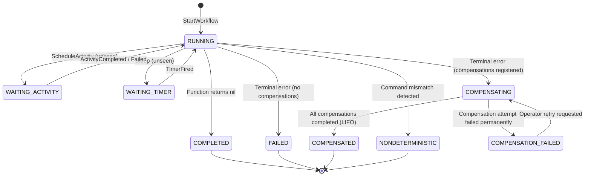

# ChronoSaga Architecture & Design Specification

## 1. System Overview & Component Boundaries

ChronoSaga is an event-sourced, durable workflow orchestrator. It consists of four logical components that interact via a single authoritative PostgreSQL database:

```text
               +----------------------------------------+
               |           Client / CLI / HTTP          |
               +-------------------+--------------------+
                                   |
                                   v
               +----------------------------------------+
               |             HTTP API Layer             |
               |  - Start workflow (idempotent)         |
               |  - Query workflow status & history     |
               |  - Trigger operator compensation retry |
               |  - Health checks & Prometheus metrics  |
               +-------------------+--------------------+
                                   |
                                   v
+----------------------------------------------------------------------+
|                     PostgreSQL Authoritative Store                   |
|  - workflow_events    : Append-only immutable history log            |
|  - workflow_runs      : Projection table with status, lease & seq    |
|  - activity_tasks     : Durable queue for forward activities         |
|  - compensation_tasks : Durable queue for LIFO reverse compensation  |
|  - timer_tasks        : Durable timers with target fire timestamps   |
|  - demo_effects       : Domain mock ledger with idempotency keys     |
+-------------------+------------------------------+-------------------+
                    ^                              ^
                    |                              |
+-------------------+------------------+  +--------+-------------------+
|       Orchestrator Scheduler         |  |   Activity Worker Pool     |
|  - Polls runnable workflows          |  |  - Claims tasks via        |
|  - Claims workflow lease             |  |    `FOR UPDATE SKIP LOCKED`|
|  - Replays workflow definitions      |  |  - Executes activity logic |
|  - Emits commands & appends events   |  |  - Fencing token check on  |
|  - Manages timers & compensations    |  |    completion / failure    |
+--------------------------------------+  +----------------------------+
```

### Component Roles
1. **HTTP API**: Validates incoming requests, enforces start idempotency via unique constraints, appends `WorkflowStarted` events, and exposes read APIs (status, paginated event history).
2. **Orchestrator Engine & Scheduler**: Claims eligible workflow runs, executes workflow definitions against historical events, detects non-determinism, appends command events, schedules activity/timer tasks, and drives compensation.
3. **Activity Workers**: Concurrently poll and claim tasks from `activity_tasks` or `compensation_tasks` using `SELECT ... FOR UPDATE SKIP LOCKED`, incrementing lease fencing generations. They execute the activity handler outside database transactions and commit completions using the fencing generation.
4. **Timer Scheduler**: Scans `timer_tasks` for overdue timers, atomically fires them, and appends `TimerFired` events, triggering workflow replay.
5. **PostgreSQL**: Authoritative single source of truth. All workflow decisions, tasks, and timer firings are committed in strict transactional boundaries.

---

## 2. Transaction Matrix & Atomicity Boundaries

To guarantee durability and prevent orphaned tasks or inconsistent history, all operations obey strict atomic database transaction boundaries:

| Operation | Tables Mutated in Single Transaction | Events Appended | Invariant Guaranteed |
|---|---|---|---|
| **Workflow Start** | `workflow_runs`, `workflow_events` | `WorkflowStarted` | A run record cannot exist without its initial event; duplicate start idempotency key is rejected or returns existing run. |
| **Schedule Activity** | `workflow_runs`, `workflow_events`, `activity_tasks` | `ActivityScheduled` | Task cannot be scheduled in queue without an immutable event and run sequence advance. |
| **Claim Task** | `activity_tasks`, `workflow_events` | `ActivityAttemptStarted` | Worker claims task using `SKIP LOCKED`, increments `lease_generation`, sets `lease_owner` and `lease_expires_at`. |
| **Complete Task** | `activity_tasks`, `workflow_runs`, `workflow_events` | `ActivityCompleted` | Verified via `WHERE task_id = $1 AND lease_generation = $2`. Stale worker cannot commit completion. Advances run to ready for replay. |
| **Fail Task (Retry)** | `activity_tasks`, `workflow_events` | `ActivityAttemptFailed`, `ActivityRetryScheduled` | Increments attempt count, calculates and sets `available_at` with exponential backoff. |
| **Fail Task (Terminal)**| `activity_tasks`, `workflow_runs`, `workflow_events` | `ActivityAttemptFailed`, `ActivityFailedFinal` | Marks task permanently failed; updates workflow run to trigger error during replay. |
| **Register Compensation**| `workflow_runs`, `workflow_events`, `compensation_tasks` | `CompensationRegistered` | Durably recorded during replay after forward activity success; cannot proceed forward until committed. |
| **Start Timer** | `workflow_runs`, `workflow_events`, `timer_tasks` | `TimerStarted` | Timer row created with immutable `due_at`; run status updated to `WAITING_TIMER`. |
| **Fire Timer** | `timer_tasks`, `workflow_runs`, `workflow_events` | `TimerFired` | Claimed with CAS/locking on pending status; exactly one `TimerFired` event emitted; run marked ready to replay. |
| **Execute Compensation**| `compensation_tasks`, `workflow_events` | `CompensationAttemptStarted`, `CompensationCompleted` or `CompensationFailed` | Fenced claim; executed in LIFO order. Failure transitions workflow to `COMPENSATION_FAILED`. |
| **Operator Retry** | `compensation_tasks`, `workflow_runs`, `workflow_events` | `CompensationRetryRequested` | Resets failed compensation to pending for retry from the failure point, preserving completed compensations. |
| **Complete Workflow** | `workflow_runs`, `workflow_events` | `WorkflowCompleted` | Sets final output, marks status `COMPLETED`. |
| **Fail Workflow** | `workflow_runs`, `workflow_events` | `WorkflowFailed` | Triggered when forward failure occurs with no compensations, or terminal non-retryable error. |

---

## 3. Deterministic Replay Model

ChronoSaga relies on deterministic event-sourced execution:
1. **Replay Context**:
   - Initialized with the full ordered history of events for the workflow run (`sequence_no ASC`).
   - Tracks `commandIndex` initialized to 0.
   - Groups recorded events by `command_index` and `event_type`.
2. **Deterministic Execution Flow**:
   - The registered workflow function is re-executed from line 1.
   - When `ctx.ExecuteActivity(name, input, options, result)` is called:
     - The engine computes the canonical SHA-256 hash of `(kind, name, canonicalJSON(input), canonicalJSON(options))`.
     - It checks whether a recorded command exists at `commandIndex`.
     - **Match & Completed**: Deserializes recorded `result` payload into the caller's pointer and increments `commandIndex`. No worker task is executed.
     - **Match & Failed**: If a terminal failure is recorded, returns a typed `*ActivityError`.
     - **Match & Pending**: The task has already been scheduled and is awaiting worker completion. The engine raises a private sentinel error `ErrReplaySuspended` to halt replay cleanly without advancing further.
     - **No Command Recorded**: This is the first time the workflow reached this point. In a single database transaction, the engine appends `ActivityScheduled`, inserts the task row into `activity_tasks`, updates the workflow run status to `WAITING_ACTIVITY`, and raises `ErrReplaySuspended`.
     - **Mismatch**: If a recorded command exists at `commandIndex` but its type, activity name, or canonical hash does not match, the engine detects non-determinism, appends `WorkflowNondeterminismDetected`, marks the workflow `NONDETERMINISTIC`, and halts.
3. **Workflow Code Rules**:
   - Workflow code MUST NOT execute direct I/O, network calls, random numbers (`rand.Int`), or wall-clock queries (`time.Now()`).
   - All external work MUST be performed via activities.
   - All time pauses MUST use `ctx.Sleep(duration)`.
4. **Sentinels & User Panic Protection**:
   - Replay suspension uses a private sentinel error (`errSuspended`).
   - Replay wrappers intercept panics: if a workflow function panics with an unexpected error, it is recorded as `WorkflowFailed` rather than silently misclassified as replay suspension.

---

## 4. Workflow State Machine

The workflow lifecycle transitions through explicit states:



### State Definitions
- **`RUNNING`**: The workflow has work to replay or is currently being executed by the orchestrator scheduler.
- **`WAITING_ACTIVITY`**: Replay has suspended awaiting the completion of an in-flight activity task.
- **`WAITING_TIMER`**: Replay has suspended awaiting the expiration of a durable timer.
- **`COMPENSATING`**: Forward execution failed; the reverse compensation chain is actively being executed.
- **`COMPLETED`**: Forward workflow completed successfully.
- **`FAILED`**: Forward workflow suffered an unrecoverable failure with zero compensations registered.
- **`COMPENSATED`**: Forward workflow failed, but all registered compensations succeeded in reverse order.
- **`COMPENSATION_FAILED`**: A compensating activity failed terminally; engine paused compensation chain awaiting human intervention.
- **`NONDETERMINISTIC`**: The code produced a command that conflicted with recorded historical events.

---

## 5. Queue, Lease & Fencing Token Model

ChronoSaga uses PostgreSQL as an ACID-compliant distributed task queue:
1. **Atomic Task Claim**:
   ```sql
   SELECT task_id, workflow_id, command_index, activity_type, input_payload, 
          retry_policy, attempt, lease_generation
   FROM activity_tasks
   WHERE status = 'PENDING' AND available_at <= NOW()
   ORDER BY available_at ASC, task_id ASC
   LIMIT 1
   FOR UPDATE SKIP LOCKED;
   ```
2. **Lease Allocation & Generation Increment**:
   ```sql
   UPDATE activity_tasks
   SET status = 'RUNNING',
       lease_owner = $1,
       lease_generation = lease_generation + 1,
       lease_expires_at = NOW() + $2::interval,
       attempt = attempt + 1,
       updated_at = NOW()
   WHERE task_id = $3;
   ```
3. **Execution Outside DB Transaction**:
   The worker commits the claim transaction before invoking the activity handler, ensuring database locks are never held during long-running tasks.
4. **Fencing on Completion**:
   When the worker finishes, it submits the result with its assigned `lease_generation`:
   ```sql
   UPDATE activity_tasks
   SET status = 'COMPLETED',
       result_payload = $1,
       lease_owner = NULL,
       lease_expires_at = NULL,
       updated_at = NOW()
   WHERE task_id = $2 
     AND lease_generation = $3 
     AND status = 'RUNNING';
   ```
   If the worker took longer than the lease duration and another worker reclaimed the task (incrementing `lease_generation`), the stale worker's completion update affects 0 rows and is rejected.

---

## 6. Saga Compensation Engine

1. **Registration**:
   - `ctx.RegisterCompensation(name, input, options)` is executed only after the forward activity has succeeded.
   - It appends a `CompensationRegistered` event and inserts a record in `compensation_tasks` linked to the workflow run and ordered by a monotonically increasing compensation order index.
2. **Reverse Order (LIFO)**:
   - When a forward activity fails terminally or the workflow returns a terminal error, the orchestrator identifies all completed compensations.
   - It dispatches them one at a time in descending order (`order_index DESC`).
3. **Durable Progress**:
   - Each compensation execution produces `CompensationAttemptStarted`, `CompensationCompleted`, or `CompensationFailed` events.
   - If the orchestrator or worker crashes midway through the compensation sequence, on recovery it discovers which compensations are completed and picks up the next uncompleted compensation without re-running earlier ones.
4. **Failure & Operator Intervention**:
   - If a compensation exhausts its retries, the workflow transitions to `COMPENSATION_FAILED`.
   - The engine will NOT skip to the next compensation automatically because ordering dependencies could cause cascading damage.
   - An operator can invoke `POST /api/v1/workflows/{id}/retry-compensation` to reset the failed compensation's status and trigger re-execution.

---

## 7. Durable Timers

1. **Timer Command**:
   - `ctx.Sleep(duration)` computes `due_at = now + duration`.
   - On first execution, it appends `TimerStarted` and inserts a row into `timer_tasks` with `due_at` and `status = 'PENDING'`.
2. **Timer Scheduler**:
   - Periodically polls `timer_tasks WHERE status = 'PENDING' AND due_at <= NOW()`.
   - Atomically updates status to `'FIRED'` and appends `TimerFired` to `workflow_events` while waking the workflow run (`status = 'RUNNING'`).
3. **Crash Recovery**:
   - If the orchestrator crashes while a timer is pending, the timer row remains in PostgreSQL.
   - When restarted, the timer scheduler immediately finds any timers whose `due_at <= NOW()`, fires them, and workflow replay resumes from `Sleep`.
